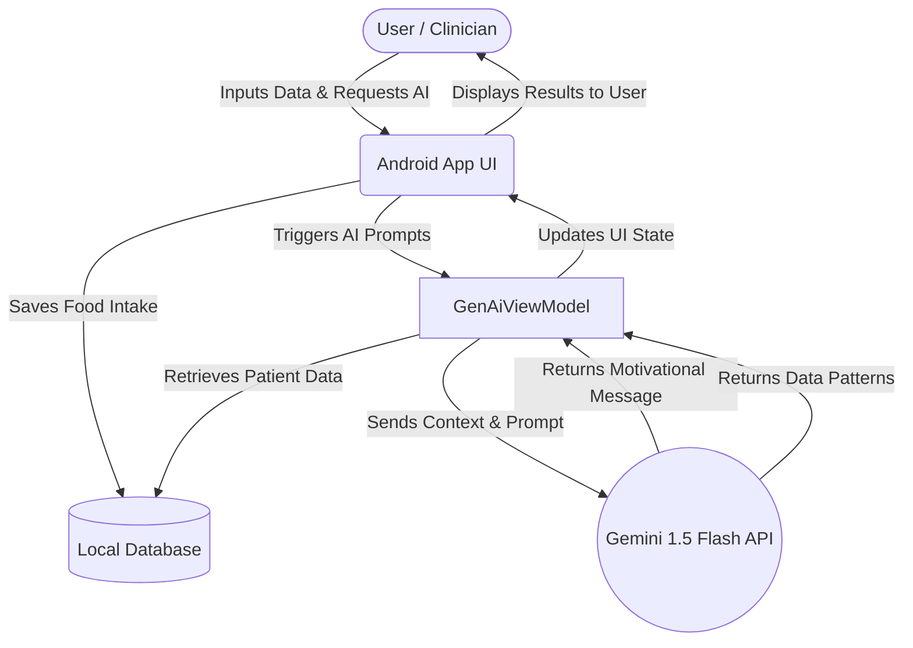

# NutriTrack: AI-Powered Dietary Coach

NutriTrack is an Android application that helps users track their daily nutritional intake and provides personalized dietary coaching using the Gemini AI API.

This document serves as the Standard Operating Procedure (SOP) for setting up the environment and a user guide for navigating the application.

## 1. System Architecture

## 2. Prerequisites & Installation
To run this project locally, you will need:
*   Android Studio (Iguana or newer)
*   A Gemini API Key (Get one at Google AI Studio)
*   Minimum SDK: API 24 (Android 7.0)

**Setup Steps:**
1. Clone the repository: `git clone https://github.com/elicwx/NutriTrack_Pro_Elijah_Chin_35681756.git`
2. Open the project in Android Studio.
3. Create a `local.properties` file in the root directory and add your API key:
   `apiKey=your_api_key_here`
4. Sync Gradle and click **Run** to deploy to your emulator.

## 3. User Guide: How to Use NutriTrack

**First login**
1. Open the app and tap the **Login** button at the bottom of the opening screen.
2. In the Login screen, tap the **Register** button.
3. In the Registration screen, select your user ID and phone number from a preloaded list, and fill in your name and set a password.
4. Tap **Continue** to finish registration, and it will take you back to the login screen.
5. Select your user ID and enter your password and tap **Continue** to login. For future logins, you can skip straight to this step without registering.

**Food Intake Questionnaire**
1. The first screen that pops up after the login is the Food Intake Questionnaire. Fill up the questionnaire and press **Save**.
2. Later, if you want to update your Food Intake details, you can do so by tapping the **Edit** button at the top right corner of the Home page.

**Finding Food Quality Score**
1. Tap the **Insights** button in the bottom navigation bar or tap the **See all scores** button next to "My Score" in the home page.
2. Review your food score insights and total quality score.
3. Tap the **Share with someone** button floating action button to share your quality score to another application.
4. Tap the **Improve my diet!** button to take you to the NutriCoach tab.

**Using the NutriCoach**
1. Tap the **NutriCoach** button in the bottom navigation bar.
2. Type a fruit in the provided text box.
3. Tap the **Details** button to the right of the text box. It will display nutritional information about the fruit.
4. Tap the **Motivational Message (AI)** button to generate a motivational message from Gemini AI to encourage you to be more healthy.
5. Tap the **Tip Bank** button at the bottom of the screen to see all previously generated Motivational Messages.

**Accessing Clinician Dashboard**
1. Tap the **Settings** button in the bottom navigation bar.
2. Enter the password "dollar-entry-apples" (without the quotation marks) and press login.
3. The average HEIFA for both males and females will be displayed.
4. Tap the **Find Data Pattern** button to get 3 observations from users' data, generated by Gemini AI.
5. Tapping the **Done** button takes you back to the **Settings** tab.

**Viewing Personal Information**
1. Tap the **Settings** button in the bottom navigation bar.
2. Your name, phone number, and user ID will be displayed in the **Settings** tab.

**Logging Out**
1. Tap the **Settings** button in the bottom navigation bar.
2. Tap **Logout** under the "Other Settings" section.

## 4. Troubleshooting
*  **"API Error" on NutriCoach Tab:** Ensure your device is connected to the internet and your `apiKey` is correctly set in `local.properties`.
*  **Wrong Password when accessing the Clinician Dashboard:** If it says "Wrong Password", ensure that you manually key in the password instead of copy and pasting it.
